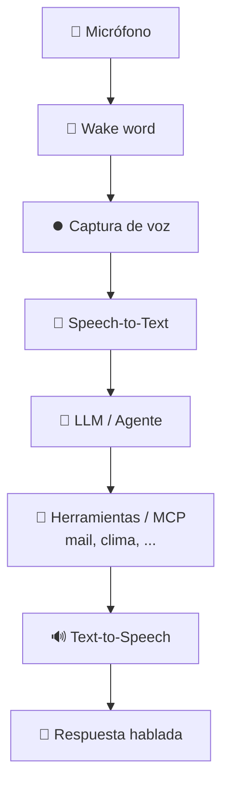

# 🎙️ Voice Assistant

Asistente de voz en Python que se activa con una palabra o frase personalizada
(por ejemplo, *"Hola Deby"*) y resuelve pedidos del usuario mediante un
**LLM / Agente** con acceso a herramientas y servidores **MCP** (correo, clima, etc.).

## 🧩 Etapas de un asistente de voz



1. 🔑 **Wake word** — el asistente escucha de forma continua y se activa al
   detectar la palabra clave (*"Deby"*).
2. ⏺️ **Captura de voz** — una vez activado, graba el comando del usuario.
3. 📝 **Speech-to-Text** — transcribe el audio a texto.
4. 🤖 **LLM / Agente** — interpreta el pedido y decide qué herramientas o
   servidores MCP usar para resolverlo.
5. 🔧 **Herramientas / MCP** — ejecutan la acción (correo, clima, etc.).
6. 🔊 **Text-to-Speech** — convierte la respuesta en voz.

## 📋 Requisitos

- 🐍 Python 3.11 — **requerido**. `openwakeword` no es compatible con
  versiones superiores (3.12+).
- 📦 [uv](https://docs.astral.sh/uv/) para gestión de dependencias

## ⚙️ Instalación

```bash
uv sync
```

## ▶️ Uso

```bash
python -m voice_assistant
```

## 🔧 Configuración

Las variables de entorno se cargan desde un archivo `.env`:

```bash
cp .env.example .env
```

El asistente soporta dos motores de wake word, seleccionables con
`WAKE_WORD_ENGINE`:

- `openwakeword` (default): modelos preentrenados (`alexa`, `hey_jarvis`, ...)
  o `.tflite` custom.
- `heed`: modelo custom entrenado con heed (ver
  [`docs/wake-word-training.md`](docs/wake-word-training.md)).

| Variable              | Descripción                                                     | Valor por defecto |
|-----------------------|-----------------------------------------------------------------|-------------------|
| `LOG_LEVEL`           | Nivel de logging (`DEBUG`, `INFO`, `WARNING`, ...)              | `DEBUG`           |
| `WAKE_WORD_ENGINE`    | Motor de detección: `openwakeword` o `heed`                     | `openwakeword`    |
| `WAKE_WORD_MODEL`     | Modelo: nombre preentrenado / ruta a `.tflite` (openwakeword) o ruta al `.onnx` (heed) | `alexa` |
| `WAKE_WORD_NAME`      | (openwakeword) Nombre de la wake word (key del modelo)          | `alexa`           |
| `WAKE_WORD_INFERENCE_FRAMEWORK` | (openwakeword) Framework del modelo: `tflite` u `onnx` | `tflite`     |
| `WAKE_WORD_THRESHOLD` | (openwakeword) Umbral de confianza (`0.0`–`1.0`)                | `0.5`             |
| `WAKE_WORD_METADATA`  | (heed) Ruta al `wake.json` (incluye el threshold)               | `models/wake.json`|

## 🔑 Wake word personalizada

¿Querés entrenar tu propia wake word (p. ej. *"Hola Deby"*)? Mirá
[`docs/wake-word-training.md`](docs/wake-word-training.md).

## 🧪 Tests

```bash
# Pruebas unitarias
pytest

# Pruebas de integración (requieren micrófono y audio de ejemplo)
pytest -m integration
```
