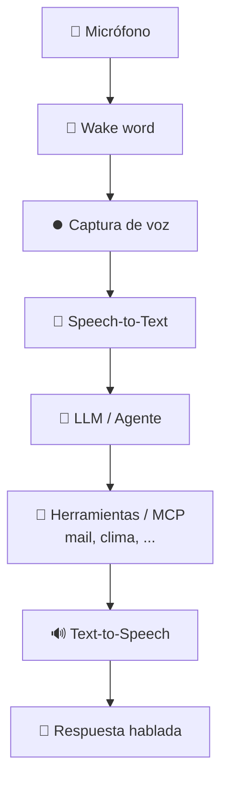

# 🎙️ Voice Assistant

Asistente de voz en Python que se activa con una palabra o frase personalizada
(por ejemplo, *"Hola Deby"*) y resuelve pedidos del usuario mediante un
**LLM / Agente**. El objetivo es dotarlo de herramientas y servidores **MCP**
(correo, clima, etc.); esa etapa está planificada (ver
[Cómo funciona](#-cómo-funciona)).

## 🧩 Cómo funciona



1. 🎤 **Micrófono** — captura audio en continuo a 16 kHz, mono (formato que
   requieren el wake word y el speech-to-text).
2. 🔑 **Wake word** — el asistente escucha de forma continua y se activa al
   detectar la palabra clave (*"Deby"*).
3. ⏺️ **Captura de voz** — una vez activado, graba el comando del usuario.
4. 📝 **Speech-to-Text** — transcribe el audio a texto.
5. 🤖 **LLM / Agente** — interpreta el pedido y genera la respuesta.
6. 🔧 **Herramientas / MCP** *(pendiente)* — ejecutarán acciones (correo,
   clima, etc.). El agente actual solo conversa; todavía no invoca herramientas.
7. 🔊 **Text-to-Speech** — convierte la respuesta en voz.

## 📋 Requisitos

- 🐍 Python 3.11 — **requerido**. `openwakeword` no es compatible con
  versiones superiores (3.12+).
- 📦 [uv](https://docs.astral.sh/uv/) para gestión de dependencias

## 📦 Instalación

```bash
uv sync
```

## ▶️ Uso

```bash
uv run voice-assistant
```

## ⚙️ Variables de entorno

Toda la configuración se pasa por variables de entorno, que se cargan desde un
archivo `.env`. Partí del ejemplo:

```bash
cp .env.example .env
```

Cada subsección corresponde a una etapa del pipeline.

| Variable    | Descripción                                        | Valor por defecto |
|-------------|----------------------------------------------------|-------------------|
| `LOG_LEVEL` | Nivel de logging (`DEBUG`, `INFO`, `WARNING`, ...) | `DEBUG`           |

### 🎤 Audio / Micrófono

La captura es fija: 16 kHz, mono, 16 bits. No hay variables de entorno para el
micrófono porque esos valores los imponen el wake word y el speech-to-text; no
deberían cambiarse.

### 🔑 Wake word

El asistente soporta dos motores de wake word, seleccionables con
`WAKE_WORD_ENGINE`:

- `openwakeword` (default): modelos preentrenados (`alexa`, `hey_jarvis`, ...)
  o `.tflite` custom.
- `heed`: modelo custom entrenado con heed (ver
  [`docs/wake-word-training.md`](docs/wake-word-training.md)).

| Variable           | Descripción                                 | Valor por defecto |
|--------------------|---------------------------------------------|-------------------|
| `WAKE_WORD_ENGINE` | Motor de detección: `openwakeword` o `heed` | `openwakeword`    |

**Opciones del motor `openwakeword`:**

| Variable              | Descripción                                                     | Valor por defecto |
|-----------------------|-----------------------------------------------------------------|-------------------|
| `WAKE_WORD_MODEL`     | Nombre preentrenado (`alexa`, `hey_jarvis`, ...) o ruta a un `.tflite` custom | `alexa` |
| `WAKE_WORD_NAME`      | Nombre de la wake word (key del modelo)                         | `alexa`           |
| `WAKE_WORD_INFERENCE_FRAMEWORK` | Framework del modelo: `tflite` u `onnx`               | `tflite`          |
| `WAKE_WORD_THRESHOLD` | Umbral de confianza (`0.0`–`1.0`). Más alto = menos falsos positivos | `0.5`        |

**Opciones del motor `heed`:**

| Variable              | Descripción                                                     | Valor por defecto |
|-----------------------|-----------------------------------------------------------------|-------------------|
| `WAKE_WORD_MODEL`     | Ruta al `.onnx` exportado (`models/wake.onnx`, o `models/wake.int8.onnx` en ARM) | `models/wake.onnx` |
| `WAKE_WORD_METADATA`  | Ruta al `wake.json` (contrato de preprocesado; incluye el threshold calibrado) | `models/wake.json` |
| `WAKE_WORD_THRESHOLD` | (opcional) Sobrescribe el threshold del `wake.json`             | *(del modelo)*    |
| `WAKE_WORD_NAME`      | (opcional) Frase esperada; si no coincide con la del modelo, el asistente no arranca | *(del modelo)* |

### 📝 Speech-to-Text

El asistente transcribe el comando con
[faster-whisper](https://github.com/SYSTRAN/faster-whisper) (Whisper sobre
CTranslate2), 100% local. El modelo se descarga automáticamente a
`STT_DOWNLOAD_ROOT` la primera vez y se cachea para los siguientes arranques.

| Variable              | Descripción                                                     | Valor por defecto |
|-----------------------|-----------------------------------------------------------------|-------------------|
| `STT_MODEL`           | Modelo Whisper (`tiny`, `base`, `small`, `medium`, `large-v3`)  | `tiny`            |
| `STT_DEVICE`          | Dispositivo de inferencia (`cpu`, `cuda`, `auto`)               | `cpu`             |
| `STT_COMPUTE_TYPE`    | Precisión numérica (`int8` recomendado en CPU, `float16`, ...)  | `int8`            |
| `STT_DOWNLOAD_ROOT`   | Directorio donde se descarga/cachea el modelo                   | `models/whisper`  |
| `STT_LANGUAGE`        | Idioma (`es`, `en`, ...). Vacío = detección automática          | `es`              |
| `STT_COMMAND_SECONDS` | Segundos de audio a capturar tras la wake word                  | `5`               |

### 🤖 LLM / Agente

El comando transcrito se envía a un **LLM** que interpreta el pedido y genera la
respuesta. Se usa un cliente compatible con la API de OpenAI, por lo que el
mismo código sirve tanto para OpenAI (cloud) como para un modelo local vía
[Ollama](https://ollama.com/) u otros proveedores compatibles (Groq, DeepSeek,
...): para cambiar de proveedor solo se ajustan `LLM_MODEL`, `LLM_API_KEY` y
`LLM_BASE_URL`.

| Variable             | Descripción                                                          | Valor por defecto |
|----------------------|----------------------------------------------------------------------|-------------------|
| `LLM_MODEL`          | Modelo (`gpt-4o-mini`, `gpt-4o`, `llama3.2`, ...)                     | `gpt-4o-mini`     |
| `LLM_API_KEY`        | Credencial del proveedor. Servidores locales sin auth: cualquier valor | *(vacío)*       |
| `LLM_BASE_URL`       | Endpoint de la API. Vacío = OpenAI. Ollama: `http://localhost:11434/v1` | *(vacío)*      |
| `LLM_TEMPERATURE`    | Aleatoriedad del muestreo (`0.0`–`2.0`). Más bajo = más determinista | `0.7`             |
| `AGENT_SYSTEM_PROMPT`| Instrucción de sistema (personalidad/estilo). Vacío = default        | *(vacío)*         |
| `AGENT_KEEP_HISTORY` | `true` recuerda la conversación previa; `false` = comandos sueltos   | `true`            |

> 💡 Para usar un modelo local con Ollama (100% offline): `LLM_BASE_URL=http://localhost:11434/v1`,
> `LLM_API_KEY=ollama` y `LLM_MODEL` al nombre del modelo que tengas descargado.

### 🔧 Herramientas / MCP

*Pendiente.* El agente todavía no ejecuta herramientas ni se conecta a
servidores MCP, por lo que no hay variables de entorno para esta etapa aún.

### 🔊 Text-to-Speech

La respuesta del agente se convierte en voz con
[Piper](https://github.com/OHF-Voice/piper1-gpl) (motor neuronal ONNX), 100%
local y en CPU. La voz se descarga una vez y se cachea en `models/piper`:

```bash
uv run python -m piper.download_voices es_AR-daniela-high --data-dir models/piper
```

Hay más voces en español (`es_ES-davefx-medium`, `es_ES-sharvard-medium`,
`es_MX-claude-high`, ...); mirá el
[catálogo de voces](https://github.com/OHF-Voice/piper1-gpl/blob/main/docs/VOICES.md).

| Variable           | Descripción                                                        | Valor por defecto                        |
|--------------------|--------------------------------------------------------------------|------------------------------------------|
| `TTS_MODEL`        | Ruta al modelo de voz `.onnx` (su `.onnx.json` va junto al archivo) | `models/piper/es_AR-daniela-high.onnx`   |
| `TTS_LENGTH_SCALE` | Velocidad del habla (`1.0` nominal; mayor = más lento, menor = más rápido) | `1.0`                                    |

## 🔑 Wake word personalizada

¿Querés entrenar tu propia wake word (p. ej. *"Hola Deby"*)? Mirá
[`docs/wake-word-training.md`](docs/wake-word-training.md).

## 🧪 Tests

```bash
# Pruebas unitarias
uv run pytest

# Pruebas de integración (requieren micrófono y audio de ejemplo)
uv run pytest -m integration
```
